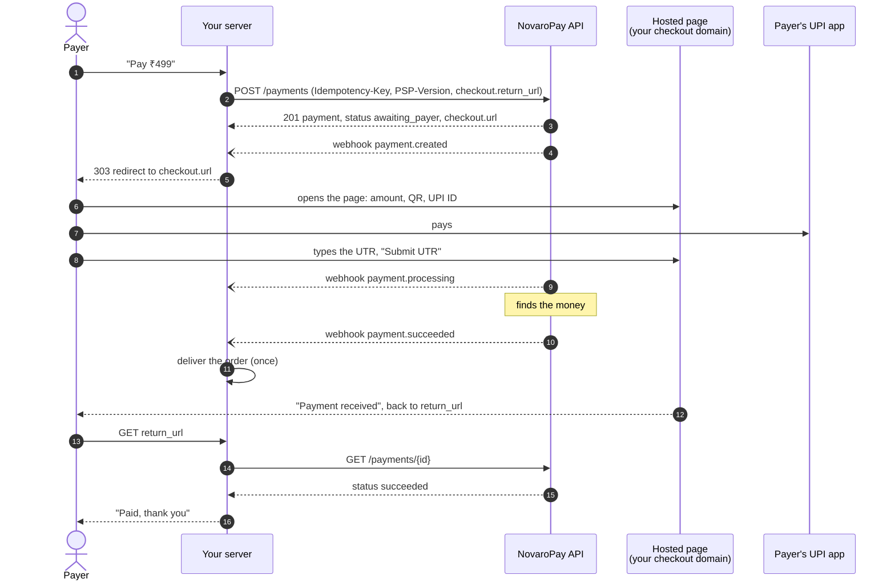
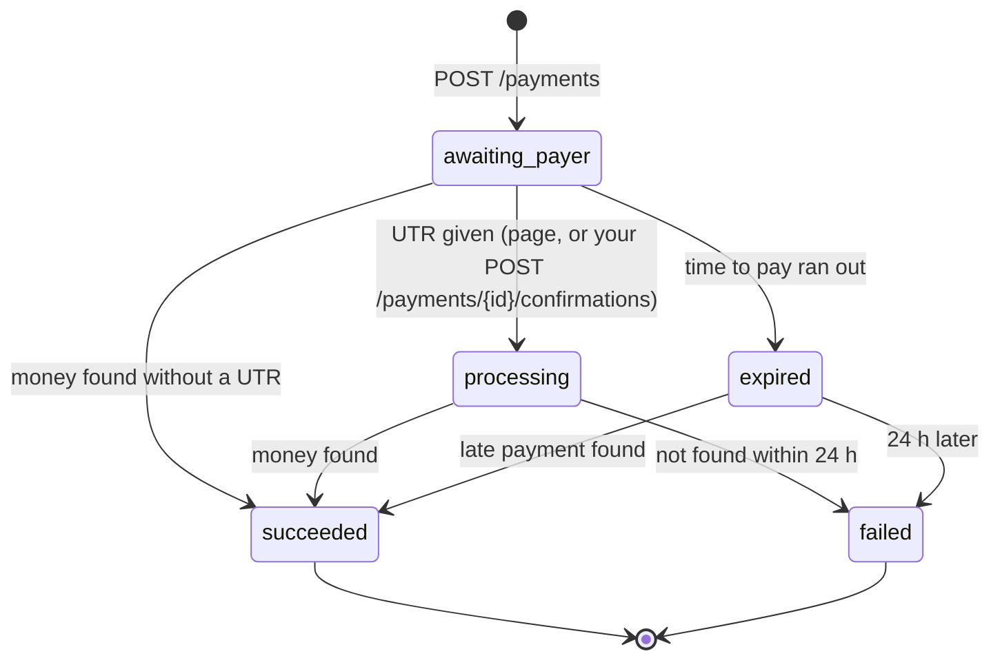

# How a payment works

One picture of who talks to whom, then where each step lives in
`src/server.mjs`. For the steps to set it up, see [INTEGRATION.md](INTEGRATION.md).

## The flow

Two things to notice:

- **Your server learns the result twice**: from the webhook (steps 9 to 11)
  and from `GET /payments/{id}` when the payer comes back (steps 14 to 15).
  Either may come first, and the payer may never come back at all. Deliver on
  whichever says `succeeded` first, once.
- **The way back carries nothing.** The page sends the payer to your
  `return_url` exactly as you gave it: no status, no payment id. Put your
  order id in it and read the payment.

## A payment's statuses

Every change sends a `payment.<status>` webhook. `data.object.version`
grows with each change of the payment: keep the highest you have seen, and
ignore anything older.

## Where it is in the code

| Step | `src/server.mjs` | What to copy |
| --- | --- | --- |
| Call the API | `api()` | `Authorization`, `PSP-Version` on every call; `Idempotency-Key` on every `POST`; retry `409`, `429`, `5xx` and network errors with the **same** key |
| Create the payment | `createOrder()` | key = order id + step, so a retry never makes a second payment; `merchant_reference` = your order id; `return_url` names the order |
| Send the payer | `POST /orders` handler | `303` to `checkout.url`, as is |
| The way back | `GET /orders/:id` handler | read the payment with `GET /payments/{id}`; refresh while `processing` |
| Receive a webhook | `webhook()` | verify on the **raw** body, `400` if it fails, `200` at once, then work |
| Apply a payment | `applyPayment()` | find the order by payment id or `merchant_reference`; skip older versions; deliver once |
| Check a signature | `src/verify.mjs` | the docs' function, unchanged |

## Test mode and live mode

They are the same code. Only the key and the webhook secret change:

| | Test | Live |
| --- | --- | --- |
| Key | `sk_test_in_…` | `sk_live_in_…` |
| Money | none: magic UTRs decide the result | real |
| Webhooks while you build | `novaro listen` to your machine | an endpoint on a public `https` URL |
| Webhook secret | `novaro listen --print-secret` | the endpoint's `whsec_…` in the portal |
| Retries | 4 over about 2.5 hours | 16 over about 3 days |
| IP allowlist | not applied | applied, if you set one |
